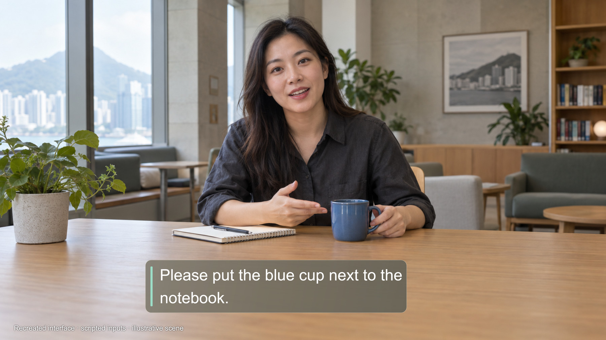

# HearLens · 听见视界

**Live captions, environmental sound cues and speech restatement in a phone-based viewer.**

Team **Lenscue**, City University of Hong Kong. Hack for SDGs 2026 · Proposed track: **Smart Living, Culture & Belonging** · SDG target **10.2**

HearLens is a working Android prototype for deaf and hard-of-hearing adults who use written captions. It brings the camera view and captions into the same viewing area, with physical controls for use while the phone stays in its viewer. We are exploring a short, seated conversation task. Benefits for target users have not yet been evaluated.

Android **0.14.1** (version code 28). Desktop receiver **1.0.2**. Latest engineering validation: **12 October 2026**. Submission packaging: **14 October 2026**.

## Downloads for reviewers

- [Android evaluation APK](https://github.com/genexing111-svg/Lenscue-HearLens/releases/download/v0.14.1-hack4sdg2026/HearLens-v0.14.1-evaluation.apk)
- [Windows receiver bundle](https://github.com/genexing111-svg/Lenscue-HearLens/releases/download/v0.14.1-hack4sdg2026/HearLens-Desktop-Receiver-v1.0.2.zip)
- [Complete source ZIP](https://github.com/genexing111-svg/Lenscue-HearLens/releases/download/v0.14.1-hack4sdg2026/Lenscue-HearLens-Source-v0.14.1.zip)
- [Editable pitch deck](https://github.com/genexing111-svg/Lenscue-HearLens/releases/download/v0.14.1-hack4sdg2026/Lenscue-Pitch-Deck.pptx)
- [24-second interface demonstration](https://github.com/genexing111-svg/Lenscue-HearLens/releases/download/v0.14.1-hack4sdg2026/Lenscue-Interface-Demo.mp4)
- [Five-minute speaking script](https://github.com/genexing111-svg/Lenscue-HearLens/releases/download/v0.14.1-hack4sdg2026/Lenscue-Pitch-Script.txt)
- [Release checksums](https://github.com/genexing111-svg/Lenscue-HearLens/releases/download/v0.14.1-hack4sdg2026/SHA256SUMS.txt)

The deck has editable full-name and team-number fields for the team to complete before the organiser's final upload. The embedded interface video is a scripted reproduction, clearly labelled on screen. A cloud credential is not included in the APK. [Review the release](https://github.com/genexing111-svg/Lenscue-HearLens/releases/tag/v0.14.1-hack4sdg2026).



*Interface reproduction with scripted text and an illustrative generated scene. See the evidence record for actual device and cloud checks.*

## Start here

- [Current scope and architecture](docs/PROJECT_STATUS_EN.md)
- [Installation and repeatable demonstration](docs/QUICKSTART_EN.md)
- [Evidence and limitations](docs/EVIDENCE_EN.md)
- [Privacy and deployment boundaries](docs/PRIVACY_EN.md)
- [Third-party components](THIRD_PARTY_NOTICES.md)

## Working features

**Captions in the view.** CameraX capture and local dual-eye rendering, adjustable caption position/size, four-line text budget and service-reported speaker colours. The phone calls cloud ASR or translation directly.

**Environmental sound cues.** Fixed YAMNet weights run locally through LiteRT. A USB serial direction board supplies measured angle reports. Calibrated, head-relative angles drive blue edge glow, with localised sound-category labels. Category-to-angle matching is a temporal estimate, not proven source identity.

**Hold to speak, release to reply.** The shoulder key starts cloud recognition/restatement and displays a top capsule. Generated audio stays buffered until release and recording stop. Previous captions remain visible while other microphone tasks pause, then resume.

**Physical controls and observer console.** SC-B03 key calibration, A for settings, X for caption language, Y for environmental perception. The optional Windows receiver shares one phone video connection, reconnects, and exposes camera, caption, direction and speech controls.

## Hardware and scope

Validated primarily with Redmi K80 Pro / Android 16, SHINECON G05 Pro passive phone viewer, SC-B03 Bluetooth controller, and a CH340 USB direction board reporting `angle: ... deg` at 115200 baud. The board's full hardware identity is not documented.

The viewer displays the phone's camera image. It is **not optical see-through AR**, does not create true binocular depth, and does not implement face-anchored speech bubbles. It is intended for controlled, stationary evaluation, not validated navigation or emergency detection.

## Reproduce

Requirements: JDK 17, Android SDK Platform 36 / Build Tools 36.0.0, supplied Gradle 8.13 wrapper. Minimum Android API 26. Receiver: Node.js 22+ (originally validated with Node.js 24).

```powershell
# Repository root, with Java and Android SDK configured:
.\gradlew.bat assembleDebug testDebugUnitTest lintDebug

# Optional observer. No npm dependency install required:
node desktop/receiver/launcher.mjs start --no-browser
# Open http://127.0.0.1:18780

node --test desktop/receiver/test/*.test.mjs
```

Use Android Studio to generate `local.properties`. Install your built APK from `app/build/outputs/apk/debug/app-debug.apk`, or the competition APK supplied separately. It is a **debug-signed evaluation build**, not a store release. A locally rebuilt APK signed with a different key cannot overwrite an installation using the original signature.

Cloud speech requires your own supported Alibaba Cloud Model Studio credentials and network access. Enter the key on the phone. Provider availability and charges can change. No live key, signing keystore, device token store, private recording or local toolchain is included.

## Evidence

The release record reports **140 Android JVM tests passed**, **5 receiver tests passed**, and **0 Lint errors / 14 existing warnings**. The copied receiver suite was rerun on 14 October and passed 5/5.

A documented 100.035-second real-board sample received 2,135 JPEGs, typically about 22 fps wireless and 59 fps phone display. It also recorded an unexplained 2.85-second pause. These are frame-delivery observations, not speech latency or clinical outcomes. [Read the conditions](docs/EVIDENCE_EN.md).

## Layout

| Path | Purpose |
| --- | --- |
| `app/src/main` | Kotlin application and bundled model |
| `app/src/test` | JVM regression tests and synthetic fixtures |
| `app/src/androidTest` | Device checks with fixed public inputs |
| `desktop/receiver` | Current local observer/control console |
| `docs/environment-reference` | Frozen audio-filter and glow contracts |
| `docs` | English entry points and dated engineering records |
| `scripts` | Build and diagnostic helpers |

Historical Chinese documents describe their named release. The current English status pages explain today's scope. Presentation media uses clearly labelled scripted interface reproductions and does not replace device evidence.

## Team and reuse

Lenscue has four members, all at City University of Hong Kong. The interim report assigns G to software, Arthur to hardware, and Louis / Eva to research and pitch. Members will fill their official full names and team number on the submission cover.

Original source is shared for competition review. No blanket open-source licence is granted for original project code. Third-party components retain their licences, including notices bundled under `app/src/main/assets/third-party`.
